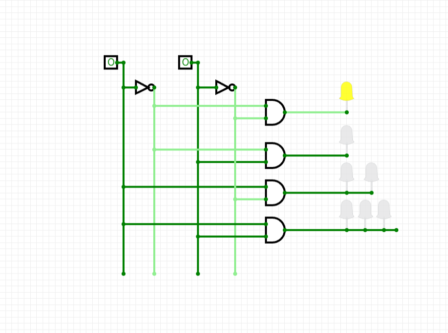

# 2-to-4 Decoder

A 2-to-4 decoder digital circuit simulation created using CircuitVerse.

## Inputs

- A
- B

## Outputs

- Y0
- Y1
- Y2
- Y3

## Working

A 2-to-4 decoder converts 2 binary inputs into 4 unique outputs.

Only one output is HIGH (1) for each input combination.

## Truth Table

| A | B | Y0 | Y1 | Y2 | Y3 |
|---|---|----|----|----|----|
| 0 | 0 | 1  | 0  | 0  | 0  |
| 0 | 1 | 0  | 1  | 0  | 0  |
| 1 | 0 | 0  | 0  | 1  | 0  |
| 1 | 1 | 0  | 0  | 0  | 1  |

## Boolean Expressions

Y0 = NOT A AND NOT B

Y1 = NOT A AND B

Y2 = A AND NOT B

Y3 = A AND B
## Real-Life Application

A decoder is used in many systems to select one specific device or operation from a binary input.

### Example: Elevator Floor Selection

A 2-to-4 decoder can be used to select one of four floors.

The two binary inputs represent the selected floor:

| A | B | Selected Floor |
|---|---|----------------|
| 0 | 0 | Ground Floor   |
| 0 | 1 | 1st Floor      |
| 1 | 0 | 2nd Floor      |
| 1 | 1 | 3rd Floor      |

Only the output corresponding to the selected floor becomes HIGH.
### Floor Indication

- 00 → 🟡 Yellow light → Ground Floor
- 01 → 🟢 1 Green light → 1st Floor
- 10 → 🟢🟢 2 Green lights → 2nd Floor
- 11 → 🟢🟢🟢 3 Green lights → 3rd Floor

Only the required floor indication is activated according to the selected binary input.

### Example

If the input is `10`, the elevator is at/selected for the **2nd Floor**, so **two green lights** are displayed.

### Other Real-Life Applications

- Memory address decoding
- Device selection in microprocessor systems
- Display selection
- Digital control systems
- Communication systems
- Data routing

## Tool Used

CircuitVerse

## Status

Completed
