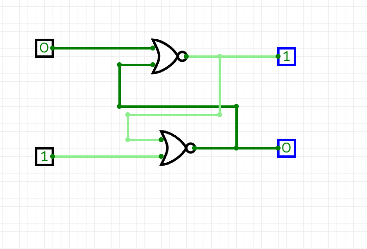
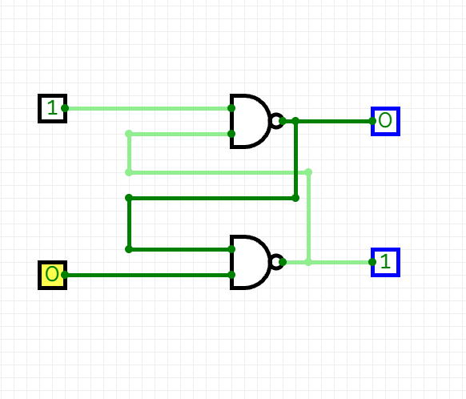

# SR Latch Using NOR and NAND Gates

## 📌 Introduction

An SR (Set-Reset) Latch is a basic memory element in digital electronics. It is a bistable circuit that can store one bit of information (0 or 1).

SR Latches can be implemented using:
1. NOR Gates
2. NAND Gates

Both circuits use two cross-coupled logic gates to store data.

## 1. SR Latch Using NOR Gates

### Circuit Description

A NOR-based SR Latch consists of two cross-coupled NOR gates.

**Inputs:**
- S = Set
- R = Reset

**Outputs:**
- Q = Normal Output
- Q̅ = Complement Output

### Truth Table

| S | R | Q (Next State) | Q̅ (Next State) | Operation |
|---|---|---|---|---|
| 0 | 0 | Previous | Previous | Hold |
| 0 | 1 | 0 | 1 | Reset |
| 1 | 0 | 1 | 0 | Set |
| 1 | 1 | 0 | 0 | Invalid |

### Working Principle

- S = 1, R = 0 → SET: Q becomes 1.
- S = 0, R = 1 → RESET: Q becomes 0.
- S = 0, R = 0 → HOLD: Previous state is maintained.
- S = 1, R = 1 → INVALID: Both outputs become 0.

**Important:** NOR-based SR Latch has active-HIGH inputs.

## 2. SR Latch Using NAND Gates

### Circuit Description

A NAND-based SR Latch also consists of two cross-coupled NAND gates.

**Inputs:**
- S̅ = Active-LOW Set
- R̅ = Active-LOW Reset

**Outputs:**
- Q = Normal Output
- Q̅ = Complement Output

### Truth Table

| S̅ | R̅ | Q (Next State) | Q̅ (Next State) | Operation |
|---|---|---|---|---|
| 1 | 1 | Previous | Previous | Hold |
| 0 | 1 | 1 | 0 | Set |
| 1 | 0 | 0 | 1 | Reset |
| 0 | 0 | 1 | 1 | Invalid |

### Working Principle

- S̅ = 0, R̅ = 1 → SET: Q becomes 1.
- S̅ = 1, R̅ = 0 → RESET: Q becomes 0.
- S̅ = 1, R̅ = 1 → HOLD: Previous state is maintained.
- S̅ = 0, R̅ = 0 → INVALID: Both outputs become 1.

**Important:** NAND-based SR Latch has active-LOW inputs.

## 3. Difference Between NOR and NAND SR Latches

| Feature | NOR SR Latch | NAND SR Latch |
|---|---|---|
| Logic gates | NOR | NAND |
| Input type | Active HIGH | Active LOW |
| Set condition | S = 1 | S̅ = 0 |
| Reset condition | R = 1 | R̅ = 0 |
| Hold condition | S = 0, R = 0 | S̅ = 1, R̅ = 1 |
| Invalid condition | S = 1, R = 1 | S̅ = 0, R̅ = 0 |
## Circuit Diagrams

### SR Latch Using NOR Gates

### SR Latch Using NAND Gates

## 4. Applications

- Temporary data storage
- Memory circuits
- Digital systems
- Control circuits
- Sequential logic circuits

## 5. Simulation

Both SR Latches can be designed and simulated using **CircuitVerse**.

Simulation platform: https://circuitverse.org/

The simulation helps us understand:
- Set operation
- Reset operation
- Hold operation
- Invalid condition
- Cross-coupled feedback connections

## 6. Key Learnings

1. An SR Latch stores one bit of information.
2. NOR-based SR Latches use active-HIGH inputs.
3. NAND-based SR Latches use active-LOW inputs.
4. Cross-coupled gates provide memory functionality.
5. Both circuits have an invalid input condition.

## Conclusion

SR Latches are fundamental building blocks of digital electronics. By implementing SR Latches using NOR and NAND gates, we can understand the basic concept of memory storage, feedback connections, and bistable circuits.
